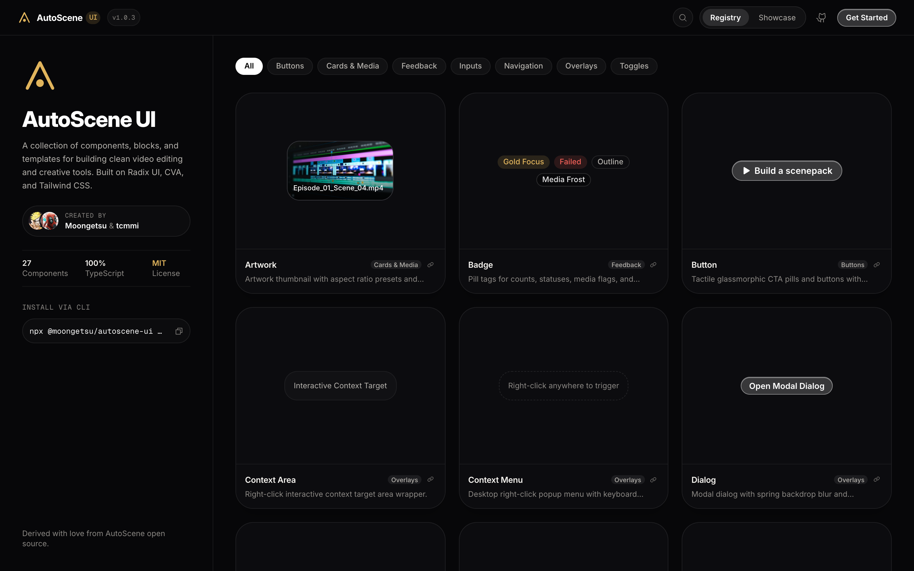

<div align="center">


# AutoScene UI Library

A standalone dark mode component library extracted from AutoScene for creative and video editing tools.

[](https://www.typescriptlang.org/)
[](https://react.dev/)
[](https://tailwindcss.com/)
[](LICENSE)

[Live Demo](https://moongetsu.github.io/AutoScene-UI-Library/) • [Installation](#installation) • [Components](#components) • [Tokens](#design-tokens) • [Credits](#credits)

---

</div>

## Preview



---

## Overview

AutoScene UI is a collection of React components designed for dark interfaces, media workspaces, and video analysis tools. It was extracted directly from the open source [AutoScene](https://github.com/tcmmi/AutoScene) desktop application and rebuilt as an independent, framework-agnostic web library.

### Key Characteristics
* **Dark Surfaces**: Layered dark tones (`#050506` through `#202025`) suited for footage viewing and long editing sessions.
* **Frosted Borders and Overlays**: Subtle borders, backdrop blurs, and glass layers.
* **Warm Gold Accents**: High contrast indicators (`#e0b45c`) for active operations, selections, and focus rings.
* **Zero Desktop Coupling**: Runs in any standard modern web browser with React 18 or 19. The package carries no Tauri code, and the site answers the app's calls from a mock backend.

---

## Installation

Install the package via npm:

```bash
npm install @moongetsu/autoscene-ui @phosphor-icons/react
```

Or run the CLI to copy a primitive into your project, with the files it needs:

```bash
npx @moongetsu/autoscene-ui list
npx @moongetsu/autoscene-ui add button
```

Components go to `src/components/ui` (`--dir` changes that). The files they share, like `components/icons.ts` and `lib/utils.ts`, go under `src` (`--src` changes that), and one you already have is kept. Your project needs the `@/` alias to point there. `topbar` uses `@tanstack/react-router`, and its Show the rail button comes from `TopBarRail` (`lib/top-bar-rail.ts`): a page without a rail gives nothing and has no such button. `card-grid` and `discord-mark` bring `lib/grid.ts` and `components/brand/DiscordMark.tsx`.

### Usage

Import components into your React app:

```tsx
import { Button, Badge, Input, Switch, Slider, Tooltip } from "@moongetsu/autoscene-ui"
import "@moongetsu/autoscene-ui/styles.css"

export default function App() {
  return (
    <div className="p-8 flex flex-col gap-4">
      <Button variant="primary">Process Scene</Button>
      <Badge tone="accent">Ready</Badge>
    </div>
  )
}
```

---

## Components

The catalog lists 62 entries: 41 primitives and 21 feature components. It is one file, `src/registry/catalog.json`: the registry, the showcase counts, the command palette and the static pages all read it.

### Primitives

| Category | Components |
| :--- | :--- |
| **Buttons** | `Button` |
| **Toggles** | `Segmented`, `Switch`, `Checkbox`, `Slider`, `OptionRow`, `ToggleChip` |
| **Inputs** | `Input`, `Field`, `Select`, `SearchField` |
| **Feedback** | `Badge`, `Banner`, `Progress`, `ProgressRing`, `Skeleton`, `Kbd`, `Toaster`, `ErrorState` |
| **Overlays** | `Dialog`, `ConfirmDialog`, `Sheet`, `DropdownMenu`, `ContextMenu`, `Tooltip`, `ContextArea`, `MenuActions` |
| **Cards & Media** | `Artwork`, `Avatar`, `Hero`, `Shelf`, `EmptyState`, `VirtualGrid`, `CARD_GRID`, `CardMenuButton`, `CardPlayButton`, `SettingsGroup`, `SettingRow`, `PathText`, `DiscordMark` |
| **Navigation** | `TopBar`, `Page`, `FilterBar` |

Some props worth knowing:

- `Button` `busy`: clicks do nothing and it keeps its focus and width. A spinner takes the place of its first icon, or stands over the hidden label when it has none. A ghost icon button stays lit while its menu is up.
- `Badge` `size="sm"`, and `tone="picture"` for the quiet one on a card's picture. `Banner` `tone="neutral"` says how things stand when nothing is wrong.
- `ErrorState` `retrying`, `icon` and `actions`. `Field` `hideLabel`. `SettingRow` `below`.
- `DropdownMenuCheckboxItem` `hint`, and `DropdownMenuSub` with its trigger and content.
- `VirtualGrid` `detail` opens a full-width row under an item.
- `CardMenuButton` `over="picture"` shows it only with the pointer over a `group/art`.

### Features

Whole parts of the app, listed under Features in the registry and in the showcase. They run on the library's mock backend with made-up data, and they stay in this repo: they aren't in the npm package. Buttons, menus and dialogs work as in the app. What needs the desktop app says so, a link opens in a new tab, and a link to a place outside the preview says it opens in the app.

| Where | Components |
| :--- | :--- |
| **Plugins** | `PluginArt`, `PluginCard`, `PluginSkeletons`, `PluginsPage`, `PluginSettingsPage`, `UninstallDialog`, `WithdrawnBanner`, `CatalogCard`, `BrowseView` |
| **Player** | `DetailsPanel`, `CastTab`, `FileTab`, `TabBody`, `ShotHeader`, `PlayerKeysDialog` |
| **Library, Cast** | `ProjectCard`, `CharacterCard` |
| **Shots** | `ShotStack` (with `ShotBand`) |
| **Settings** | `HardwareGroup`, `DiscordSection` |
| **Shell** | `FastScanNotice` |

`PluginFrame`, `PluginPageView` and `PlayerPicture` are not listed: they are a sandboxed frame and a video wrapper, and show nothing without the desktop app. The `/x/` routes of plugin pages, the `.asp` file handling and the rest of the Tauri glue stay out of this repo.

### Adding a component

1. Add one line to `src/registry/catalog.json`: its id, name, category, showcase section, description and file. A feature also names where it lives (`feature`).
2. Add its preview to `COMPONENT_DEMO_PREVIEWS` (`src/registry/component-previews.tsx`), or to `FEATURE_PREVIEWS` for a feature.
3. If the package should export it, add it to `src/index.ts` and name it in the entry's `exports`. Everything else has `"exports": []`.
4. For a primitive, add it to the CLI's list, `bin/registry.json`, with the files it imports and the packages it needs. Something outside `src/components/ui` has no `files` there, only `support`, and the catalog test names it.
5. Show it in its showcase section (`src/components/showcase/sections`), with a `ShowcaseSectionStage` and its code.

`src/registry/catalog.test.ts` fails when a file in `src/components/ui` has no entry, an entry has no preview, an entry names something the package doesn't really export, a primitive isn't in the CLI, or a CLI entry lacks a file its files import. Every entry gets its static page from `scripts/prerender-routes.mjs`, and that page's address opens the entry on the site.

### Syncing with the app

The primitives, `styles/` and `lib/grid` match AutoScene at ac74138. The rest of `src/` stays at cac9adb, the commit before the app moved its words into a catalog, apart from the entries added since: `ShotStack` and the shots around it, `DiscordSection`, `PluginSkeletons`, and the shots shortcuts. The library has no catalog of words (i18next): what is copied from the app has its English written in place, so a copied `t("...")` becomes the sentence from the app's `locales/en`. `bindings.ts` is at cac9adb with the Discord types added.

Most of `src/` mirrors the AutoScene app and can be copied over. These files are the library's own forks: **a sync must merge into them, never overwrite them.**

| File | Why it differs from the app |
| :--- | :--- |
| `ui/context-menu`, `ui/dialog`, `ui/sheet`, `ui/switch` | Built on the `@animate-ui` primitives |
| `ui/dropdown-menu` | The same, with the app's scrolling and collision padding merged in |
| `ui/slider`, `ui/tooltip` | The library's own motion and placement |
| `ui/toaster` | `CleanToastCapsule`, bottom right |
| `ui/context-menu` | Also `isMac` from `lib/ua` |
| `ui/button` | `motion.button`, `cursor-pointer`, and busy has neither the spring nor the hand |
| `ui/checkbox` | `cursor-pointer` on the label |
| `ui/artwork`, `ui/avatar`, `ui/hero` | Take `path` as a URL: no `assetUrl`, so the package carries no Tauri |
| `ui/confirm-dialog` | `errorMessage` from `lib/errors` |
| `ui/topbar` | No window: no caption menu, no drag regions. The rail comes from `TopBarRail`, so it asks nothing of the app |
| `ui/error-state` | `lib/errors` for its messages, and `OpenLogs` (given in `main.tsx`) in place of the app's command |
| `ui/segmented` | Sliding pill (`layoutId`), `w-fit` |
| `brand/AutoSceneMark` | The `bare` look |
| `icons.ts` | Adds `Link`, `List` and what the showcase, `FilterBar` and the Toaster use |
| `styles/tokens.css` | Its own `--ease-out` and `--ease-spring` |
| `styles/index.css`, `styles/base.css` | The theme lives in `styles/theme.css`, shared with the package; tooltip keyframes; the page scrolls and its text can be selected |
| `shell/AppShell`, `shell/AppMenu`, `router.tsx`, `main.tsx` | The `!isTauri` web shell, the `@animate-ui` menu root with `appEntries`, the registry and showcase routes without plugin pages, the static page's address read at boot |
| `lib/ipc`, `lib/platform`, `lib/footage` | Their pure parts moved to `lib/errors` and `lib/ua`; stills read through `BASE_URL` |
| `mocks/backend`, `mocks/cast` | `reveal_path`, `open_logs_dir` and `open_url` answer as a web page can; its projects are made up or open films |
| `shell/AppShell` | Also gives `TopBarRail` |
| `shell/FastScanNotice` | The app's overlay on the Tears of Steel still: faces, names and gold frames are this still's own, and there is no mesh |

Library only, with nothing to sync: `ui/filter-bar`, `lib/motion.ts`, `lib/top-bar-rail.ts`, `lib/errors.ts`, `lib/ua.ts`, `lib/open-logs.ts`, `shell/StandaloneShell`, `styles/library.css` (what the package ships), `styles/theme.css`, `bin/`, `src/registry` and `src/components/showcase`.

Copied files lose their em and en dashes, as `AGENTS.md` asks, so expect those lines in a diff against the app. `FastScanNotice` reads its still through `footageStill`, since the site isn't served from the root.

### Footage stills

The pictures in `public/footage` are from open films and artwork under Creative Commons Attribution licences. A preview that shows one says whose it is. No studio art belongs in this repo: `FastScanNotice` stays on the Tears of Steel still with its credit, whatever the app shows there, and the mesh the app draws over its own picture stays out with it.

---

## Design Tokens

Key CSS tokens available in `src/styles/tokens.css`:

| Token | Value | Description |
| :--- | :--- | :--- |
| `--bg-inset` | `#050506` | Darkest background well |
| `--bg-canvas` | `#09090b` | Base application background |
| `--bg-panel` | `#111114` | Primary card and panel surface |
| `--bg-overlay` | `#202025` | Menus, popovers, and dialogs |
| `--accent` | `#e0b45c` | Warm gold accent color |
| `--fg-1` | `#f5f3ef` | Primary high contrast text |
| `--fg-2` | `#b4b1ac` | Muted secondary text |
| `--fg-3` | `#6d6a65` | Subtle captions and hints |
| `--line-hairline` | `rgba(255, 255, 255, 0.07)` | Translucent divider lines |

### Typography

| Family | Package | Usage |
| :--- | :--- | :--- |
| **Inter Variable** | `@fontsource-variable/inter` | Primary interface sans-serif for controls, buttons, forms, and labels |
| **Instrument Serif** | `@fontsource/instrument-serif` | Display serif for titles, card headers, and banners |
| **Geist Mono Variable** | `@fontsource-variable/geist-mono` | Monospace typeface for timecodes, counts, shortcuts, and code blocks |

---

## Development

Run the registry catalog and live documentation locally:

```bash
# Clone the repository
git clone https://github.com/moongetsu/AutoScene-UI-Library.git
cd AutoScene-UI-Library

# Install dependencies
npm install --legacy-peer-deps

# Start Vite dev server
npm run dev
```

Visit `http://localhost:5173/AutoScene-UI-Library/` to browse the registry and showcase pages.

---

## Credits & Acknowledgments

This library builds upon ideas and open source projects from the community:

* **[AutoScene](https://github.com/tcmmi/AutoScene)**: Core inspiration, visual identity, and upstream application created by [tcmmi](https://github.com/tcmmi).
* **[21st.dev](https://21st.dev)**: Design inspiration for the interactive component registry catalog layout and preview cards.
* **[animate-ui](https://github.com/animate-ui)**: Animation primitives, smooth layout transitions, and interactive physics.
* **[Radix UI](https://www.radix-ui.com/)**: Unstyled, accessible UI primitive foundations.
* **[Phosphor Icons](https://phosphoricons.com/)**: Clean, flexible icon family used across components.
* **[Sonner](https://sonner.emilkowal.ski/)**: Fast, opinionated toast engine powering the notification capsules.
* **[Tailwind CSS](https://tailwindcss.com/)**: Utility-first styling architecture.

---

## License

MIT License. See [LICENSE](LICENSE) for details. Created by [Moongetsu](https://github.com/moongetsu) and derived from [AutoScene](https://github.com/tcmmi/AutoScene).
