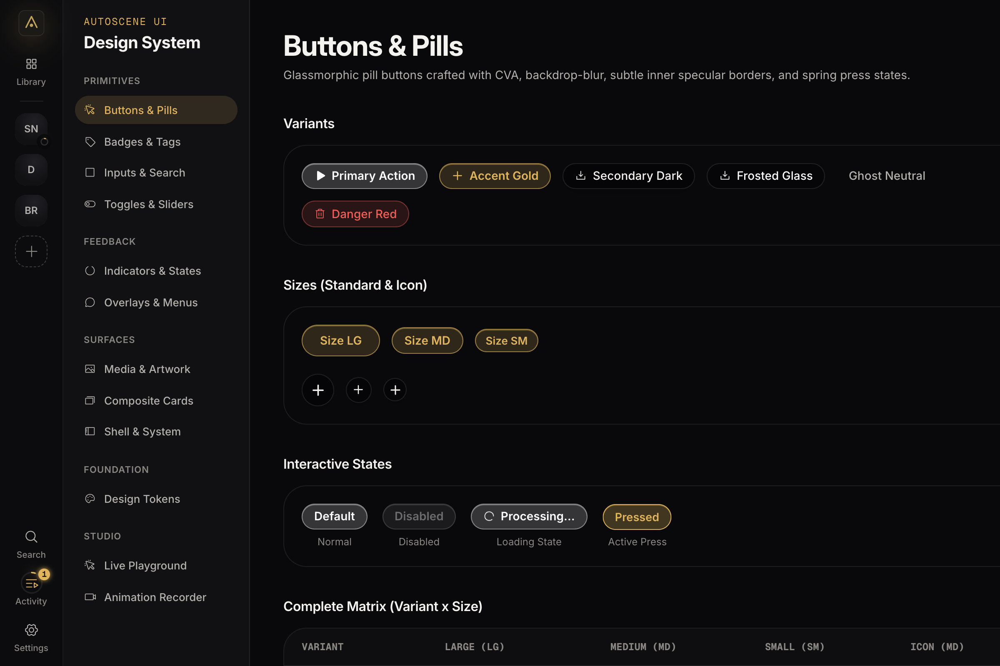
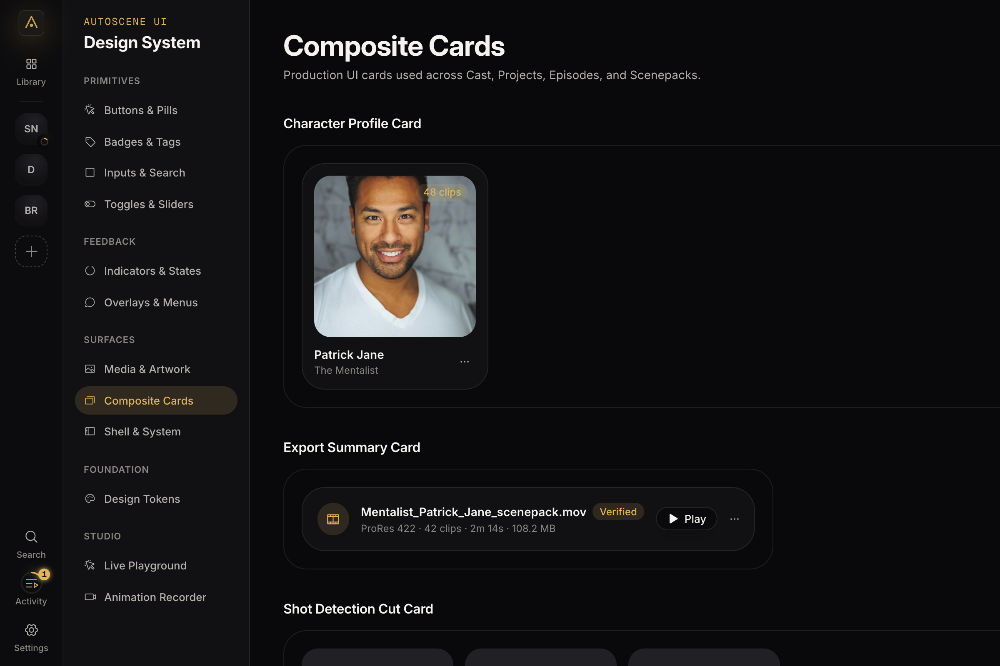

<div align="center">


# AutoScene UI Library

**The Cinematic Dark-Theatre Design System for AutoScene**

[](https://www.typescriptlang.org/)
[](https://react.dev/)
[](https://tailwindcss.com/)
[](LICENSE)

[Overview](#overview) • [Live Showcase](#live-showcase) • [Components](#components) • [Tokens](#design-tokens) • [Automated Previews](#automated-previews)

---

</div>

## Overview

The **AutoScene UI Library** is a standalone, decoupled design system extracted directly from [AutoScene](https://github.com/tcmmi/AutoScene). Built specifically for video analysis, timeline scrubbing, and high-density creative suites, it emphasizes:

- **Cinematic Dark Theatre**: Deep neutral surfaces (`#050506` to `#202025`) where pictures and footage bring the colour.
- **Glassmorphism**: Layered specular borders, subtle backdrop blurs, and translucent pills.
- **Warm Gold Accents**: High-contrast focal indicators (`#e0b45c`) for active processes and focus states.
- **Zero Rust / Tauri Coupling**: Pure web primitives (React 19 + TypeScript + Vite + Tailwind CSS).

---

## Previews

### Studio Showcase & Design System Gallery


### Glassmorphic Button System


### Automated Spring Interaction (Hover & Active Press)


### Composite Production Cards


---

## Component Architecture

Everything in the UI library is cleanly separated and modular:

```
src/
├── components/
│   ├── ui/                    # Primitive components
│   │   ├── button.tsx         # Pill & glass buttons (primary, accent, secondary, etc.)
│   │   ├── badge.tsx          # Status tags & counters
│   │   ├── input.tsx          # Text fields & search bars
│   │   ├── segmented.tsx      # Sliding pill tab switchers
│   │   ├── switch.tsx         # Boolean toggle switches
│   │   ├── slider.tsx         # Precision range sliders
│   │   ├── progress.tsx       # Determinate & indeterminate loaders
│   │   ├── kbd.tsx            # Keyboard shortcut badges
│   │   ├── tooltip.tsx        # Floating micro-tooltips
│   │   ├── dropdown-menu.tsx  # Glass context menus
│   │   └── ...
│   ├── showcase/              # Studio gallery & playground
│   │   ├── ShowcaseLayout.tsx # Studio frame with sidebar navigation
│   │   ├── sections/          # Dedicated showcase per component family
│   │   ├── playground/        # Interactive modifier (radius, blur, glow)
│   │   └── recorder/          # Isolated target for headless video capture
│   └── icons.ts               # Curated icon set (Phosphor Icons)
└── styles/
    ├── tokens.css             # Cinematic CSS variables
    └── index.css
```

---

## Getting Started

### 1. Installation
Clone the repository and install dependencies:

```bash
git clone https://github.com/moongetsu/AutoScene-UI-Library.git
cd AutoScene-UI-Library
npm install
```

### 2. Launch the UI Showcase
Start the interactive component gallery in your browser:

```bash
npm run dev
```

Navigate to `http://localhost:5173/#/showcase` to preview every variant, size, and interaction state.

### 3. Generate Previews Automatically
To capture screenshots and record button interaction GIFs with zero manual work:

```bash
node scripts/record-previews.mjs
```

This runs headless Chromium via Playwright, simulates hover and spring clicks, and encodes optimized GIFs using FFmpeg.

---

## Design Tokens

Key tokens defined in `src/styles/tokens.css`:

| Token | Hex / Value | Purpose |
| :--- | :--- | :--- |
| `--bg-inset` | `#050506` | Deepest inset well |
| `--bg-canvas` | `#09090b` | Main window background |
| `--bg-panel` | `#111114` | Primary card & panel surface |
| `--bg-overlay` | `#202025` | Popovers, modals, dropdowns |
| `--accent` | `#e0b45c` | Brand warm gold |
| `--fg-1` | `#f5f3ef` | Primary warm white text |
| `--fg-2` | `#b4b1ac` | Secondary muted text |
| `--line-hairline`| `rgba(255, 255, 255, 0.07)` | Subtle separation lines |

---

## License

MIT License. Derived with love from the AutoScene open-source project.
